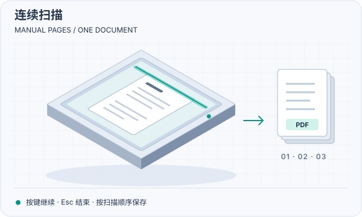
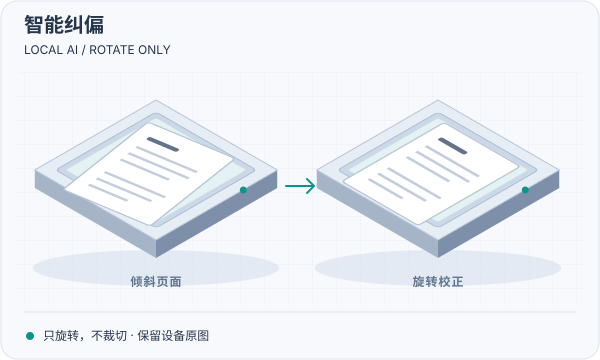
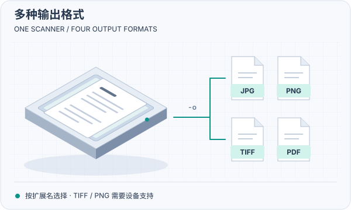

# GoScanner

**在 macOS 上使用 WSD 扫描仪，无需厂商专用扫描驱动。**

部分扫描仪和打印扫描一体机提供 WSD 扫描服务，却缺少可用的 macOS 扫描支持。GoScanner 通过 WSD 与设备通信，让你从终端完成扫描、连续换页、图像处理和文件保存。

项目目标是支持所有兼容 **WSD 扫描协议**的设备，不限制品牌和型号。这是兼容性目标，不是所有设备均已验证的承诺。目前实机验证以 **HP Laser MFP 1188w** 为主，当前能力与限制见[设备兼容性](#设备兼容性)。设备支持 WSD 打印，不代表它也支持 WSD 扫描。

## npm 安装

```bash
npm install -g @codingbone/goscanner
goscanner --help
```

要求 **macOS 14+、Apple Silicon（arm64）和 arm64 版 Node.js 22+**。Node.js 自带 npm。

包内已包含扫描程序、OpenCV、ONNX Runtime 和 AI 模型。安装时不编译、不执行安装脚本，也不额外下载运行库或模型。无需安装 Go、Xcode、Homebrew、Python 或厂商驱动。

## 第一次扫描

1. 将扫描仪和 Mac 连接到同一局域网，唤醒设备，确认设备已启用 WSD 扫描服务。
2. 将纸张放到扫描仪平板上。在终端进入希望保存文件的目录，运行：

   ```bash
   goscanner scan
   ```

3. 没有默认设备时，程序会发现设备并列出列表。输入编号，按 Enter 确认。即使只有一台，也需要确认；选择后会保存为默认设备。
4. 扫描完成后，查看终端报告的文件路径。

默认使用 **A4、150 DPI、彩色、30 秒超时**，在当前工作目录保存 `scan-时间戳.jpg`。这些默认值可通过[配置文件](#配置文件)修改。已有文件不会被覆盖。

只想先查看设备、不启动扫描，可以运行 `goscanner info`。首次使用时，它同样会要求选择并登记默认设备。

> 以下图片是功能示意，不是实机扫描结果。

## 连续扫描

<table>
<tr>
<td width="50%" valign="top">
<p><strong>手动换页，一次完成多页文档。</strong></p>
<p>程序立即扫描第一页。保存后提示换页，按任意键继续，无需回车。在换页等待时单独按 <code>Esc</code>，正常结束。</p>
<p>选择 PDF 时，结束后按扫描顺序合并为一个文件。选择图像格式时，每页分别保存。</p>
<pre><code>goscanner scan --manual -o document.pdf</code></pre>
</td>
<td width="50%"></td>
</tr>
</table>

- 图像输出以 `document-001.jpg`、`document-002.jpg` 等命名，不生成无序号的 `document.jpg`。
- 使用 `--manual --single-page -o page.pdf`，每页立即保存为 `page-001.pdf`、`page-002.pdf` 等独立 PDF。
- 换页等待没有超时；`--timeout` 分别限制发现和每页扫描。手动模式需要交互终端，不能用于没有控制终端的后台任务。
- `Ctrl+C` 表示取消，不是正常结束。后续页失败或取消时，已完成的图像不会删除；合并 PDF 模式也会尝试保存已完成页面。强制终止、崩溃或断电不能保证执行合并，可能留下暂存图像。

## 智能纠偏

<table>
<tr>
<td width="50%" valign="top">
<p><strong>识别纸张边界，校正放歪的页面。</strong></p>
<p>使用本地 AI 模型定位四角，根据可信的边线方向旋转图像。单独启用纠偏时不裁切。</p>
<p>适合纸张在平板上有小幅倾斜的情况。不识别文字方向，不做透视校正。</p>
<pre><code>goscanner scan --deskew -o aligned.png</code></pre>
</td>
<td width="50%"></td>
</tr>
</table>

纠偏默认关闭。无法可靠判断角度时，程序警告并跳过旋转。启用后会额外保留设备原始图像，便于核对，不需要另外下载模型。

## 智能裁切

<table>
<tr>
<td width="50%" valign="top">
<p><strong>减少纸张周围的平板背景。</strong></p>
<p>根据 AI 预测边界裁取外接矩形，并保留安全边距。单独启用裁切时不旋转纸张。</p>
<p>可与纠偏一起使用：先旋转，再裁切。两项功能都在本机执行，不上传图像。</p>
<pre><code>goscanner scan --autocrop -o cropped.png</code></pre>
</td>
<td width="50%"></td>
</tr>
</table>

同时启用两项处理：

```bash
goscanner scan --deskew --autocrop -o document.png
```

- 边界检测不可靠或处理出错时，程序警告并输出原图。AI 可能误定位，**处理后应检查是否丢失内容**。
- 单页原图命名为 `document-original.jpg` 或 `document-original.tiff`。连续扫描和 PDF 原图带页号，例如 `document-original-001.jpg`。PNG 的设备原图是 TIFF。
- 原图保存在最终输出目录，已有原图不会被覆盖。处理或 PDF 保存失败时，已保存的原图仍会保留。
- 裁切保留检测对象最长边的 2% 作为边距，至少 3 像素。这不能保证识别边界准确，也不能恢复设备未扫描到的纸边。

## 多种输出格式

<table>
<tr>
<td width="50%" valign="top">
<p><strong>按用途选择 JPG、PNG、TIFF 或 PDF。</strong></p>
<p>用 <code>-o</code> 的扩展名选择格式，无需另外转换。图像可逐页保存，PDF 可合并多页。</p>
<p>需要保留无损图像时选择 TIFF 或 PNG；需要整理多页文档时选择 PDF。</p>
<pre><code>goscanner scan -o document.pdf</code></pre>
</td>
<td width="50%"></td>
</tr>
</table>

| 格式 | 示例 | 保存方式与要求 |
| --- | --- | --- |
| JPEG | `goscanner scan -o page.jpg` | 请求设备 JPEG；默认输出格式，也支持 `.jpeg` |
| TIFF | `goscanner scan -o page.tiff` | 请求设备原生单页未压缩 TIFF，也支持 `.tif`；不合并为多页 TIFF |
| PNG | `goscanner scan -o page.png` | 请求原生 TIFF，再无损转换为 PNG；不经过 JPEG |
| PDF | `goscanner scan --manual -o document.pdf` | 以 JPEG 图像生成 PDF；不含 OCR 文本层 |

TIFF 和 PNG 都要求设备支持 `tiff-single-uncompressed`。设备不支持时，程序在扫描前报错，不会降级为 JPEG。

未启用图像处理时，JPEG 和 TIFF 保留设备原始图像字节，PDF 直接嵌入原始 JPEG，不重复压缩。启用处理且实际发生变换后，JPEG 以质量 95 重新编码；TIFF 和 PNG 不经过 JPEG。变换后的 TIFF 不保证保留原标签或位深；PNG 不另写 DPI 元数据。

## 命令详解

命令格式：

```text
goscanner <discover|info|scan> [参数]
```

**所有参数都放在子命令之后。** 使用 `goscanner --help` 或 `goscanner scan --help` 查看帮助。

### `discover`：发现设备

```bash
goscanner discover
```

在本机直连 IPv4 局域网内查找 WSD 扫描服务，输出 JSON 数组。不扫描，不选择设备，也不修改配置。

发现警告输出到标准错误；有可用结果时仍会列出。发现设备只表示它发布了 WSD 扫描服务，不代表所有扫描参数组合都可用。

### `info`：查看设备能力和状态

```bash
# 使用默认设备；未设置时先发现并要求选择。
goscanner info

# 临时指定设备 IP，跳过发现。
goscanner info --host 192.168.1.8

# 指定设备实际发布的扫描服务地址。
goscanner info --endpoint http://192.168.1.8:8018/wsd/scan
```

输出设备状态、支持的分辨率、色彩、格式和扫描尺寸，不启动扫描。能力列表是设备的原始声明，不代表本工具开放全部模式或参数组合。

### `scan`：扫描并保存

```bash
# A4、300 DPI、灰度，保存到桌面。
goscanner scan --dpi 300 --mode gray -o ~/Desktop/document.jpg

# 扫描设备声明的最大平板范围，而非默认 A4。
goscanner scan --area full -o full.png

# 从平板左上角向右 10 mm、向下 10 mm，扫描 50 × 50 mm。
goscanner scan --area 10,10,50,50 -o region.jpg

# 慢速设备或高分辨率扫描可适当增加超时。
goscanner scan --timeout 2m -o document.pdf
```

分辨率、区域、色彩和源格式必须在设备支持范围内。`full` 使用设备声明的完整平板范围，可能包含纸外背景；它本身不启用智能裁切。

### 设备与超时参数

下表列出内置默认值；配置文件可以覆盖部分默认值。

| 参数 | 适用命令 | 默认值 | 说明 |
| --- | --- | --- | --- |
| `--host IP` | `info`、`scan` | 无 | 指定设备 IP；未设置且无默认设备时，发现并要求选择 |
| `--port N` | `info`、`scan` | `8018` | 扫描服务端口，范围 1–65535 |
| `--path PATH` | `info`、`scan` | `/wsd/scan` | 扫描服务路径，必须以 `/` 开头 |
| `--endpoint URL` | `info`、`scan` | 无 | 完整 HTTP 扫描地址；覆盖整组设备配置，不能与上述三个参数混用 |
| `--timeout DURATION` | 全部 | `discover`：`10s`；`info`：`2m`；`scan`：`30s` | 发现、查询或每页扫描的超时，例如 `30s`、`2m`；不限制设备选择或手动换页等待 |

`8018` 和 `/wsd/scan` 不是所有 WSD 设备的统一地址。自动发现会读取设备发布的实际端口和路径；手动指定时应使用设备的真实值。

地址必须使用 IP。完整地址不接受 DNS 主机名、用户名、查询参数或片段。

超时或取消后，任务清理可能额外等待最多 10 秒。超时不是本地图像处理、PDF 合并和文件保存的硬实时停止保证。

### 扫描与输出参数

| 参数 | 默认值 | 说明 |
| --- | --- | --- |
| `--dpi N` | `150` | 分辨率，必须由设备支持 |
| `--mode color\|gray` | `color` | 彩色或灰度；不支持原生黑白模式 |
| `--area AREA` | `a4` | `a4`、`full` 或 `x,y,w,h`；自定义区域单位为毫米，原点在平板左上角 |
| `-o PATH` | 当前目录的时间戳 JPEG | 输出路径；扩展名选择格式，同时覆盖配置中的目录和格式 |
| `--manual` | `false` | 手动连续扫描，换页后按键继续，等待时按 Esc 结束 |
| `--single-page` | `false` | 仅用于 PDF；连续扫描时每页保存为独立 PDF |
| `--deskew` | `false` | 本地 AI 纠偏，只旋转，不裁切 |
| `--autocrop` | `false` | 本地 AI 裁切，只裁切，不旋转 |

`--single-page` 不会自行开启连续扫描。未指定 `--manual` 时仍只扫描一页，使用指定文件名。

## 配置文件

配置文件固定为：

```text
~/.config/goscanner/config.json
```

优先级为：**显式命令行参数 > 配置文件 > 内置默认值**。配置文件可省略任意字段，缺少的字段使用内置默认值。

首次从发现列表确认设备后，程序会自动创建或更新配置中的 `device`，保留其他设置。普通命令行覆盖不会写回配置。修改前应保留已有设备地址，不要直接用示例覆盖自动登记的配置。

### 完整示例

以下示例将默认输出改为 `~/Documents/Scans` 下的 PDF；`192.168.1.8` 是示例 IP，请替换为实际设备地址。

```json
{
  "device": {
    "host": "192.168.1.8",
    "port": 8018,
    "path": "/wsd/scan"
  },
  "scan": {
    "dpi": 150,
    "mode": "color",
    "area": "a4",
    "timeout": "30s"
  },
  "output": {
    "directory": "~/Documents/Scans",
    "format": "pdf"
  },
  "processing": {
    "deskew": false,
    "autocrop": false
  }
}
```

### 配置项

| 配置项 | 内置默认值 | 作用 |
| --- | --- | --- |
| `device.host` | `""` | 设备 IP；空值表示使用时发现并要求选择 |
| `device.port` | `8018` | 默认扫描服务端口 |
| `device.path` | `"/wsd/scan"` | 默认扫描服务路径 |
| `scan.dpi` | `150` | 默认扫描分辨率 |
| `scan.mode` | `"color"` | `"color"` 或 `"gray"` |
| `scan.area` | `"a4"` | `"a4"`、`"full"` 或毫米区域字符串，例如 `"10,10,50,50"` |
| `scan.timeout` | `"30s"` | 仅作为 `scan` 的默认超时；`discover` 和 `info` 用命令行 `--timeout` 调整 |
| `output.directory` | `"."` | 默认输出目录；自动创建不存在的目录 |
| `output.format` | `"jpg"` | `"jpg"`、`"tiff"`、`"png"` 或 `"pdf"` |
| `processing.deskew` | `false` | 默认是否纠偏 |
| `processing.autocrop` | `false` | 默认是否裁切 |

- `.` 和其他相对路径相对于**运行命令时的工作目录**，不是配置文件目录或程序目录。
- 支持 `~`、`~/...`；不支持 `~用户名`、`$HOME` 或 `${HOME}` 展开。输出目录不能为空。
- JSON 不支持注释、尾随逗号或未知字段。`config.example.json` 只是[配置示例](config.example.json)，不会自动加载。
- `--manual`、`--single-page` 和 `--endpoint` 不是配置项。

临时覆盖默认设置：

```bash
# 本次改为 JPEG；同时覆盖默认输出目录和格式。
goscanner scan -o ~/Desktop/once.jpg

# 即使配置启用了 AI，本次也不进行图像处理。
goscanner scan --deskew=false --autocrop=false
```

设备迁移、旧配置升级，以及高级环境变量 `GOSCANNER_MODEL_PATH`、`GOSCANNER_ONNXRUNTIME_PATH` 的说明，见[配置与首次使用](docs/configuration.md)。npm 用户通常无需设置这两个环境变量。

## 设备兼容性

**当前支持范围：** 局域网内提供 WSD 扫描服务、使用可访问的 HTTP/IP 扫描端点、支持当前扫描参数与源格式的平板扫描设备。

**当前不支持：** 自动进纸器（ADF）、原生黑白扫描、OCR、图形界面、仅支持 eSCL 的设备、仅通过 USB 连接的设备。发现功能不支持 IPv6、跨子网发现、WS-Discovery 2009，或仅提供 HTTPS、主机名、URN 而没有可用 HTTP/IP 扫描端点的服务。npm 包暂不支持 Intel Mac、Linux 或 Windows。

| 验证对象 | 已知情况 |
| --- | --- |
| HP Laser MFP 1188w | 已验证 WSD 发现、能力读取，以及多种彩色、灰度、JPEG、TIFF、PNG 扫描组合；不代表任意参数组合均可用 |
| PDF | 已通过本机结构与渲染检查，并收到用户实测通过反馈；不同模式和异常场景未全部进行实机验证 |
| 其他兼容 WSD 的设备 | 可以尝试，但尚无实机验证保证；可能需要适配设备差异 |

手动连续扫描、当前交互选择与登记流程已通过模拟设备和终端测试，尚未完成对应的实机流程验证。测试与实机结论分开记录，详见 [WSD 扫描验证](VERIFICATION.md)、[发现验证](DISCOVERY-VERIFICATION.md)、[TIFF/PNG 验证](TIFF-PNG-VERIFICATION.md)和[图像处理验证](PREPROCESSING-VERIFICATION.md)。

## 常见问题与文件安全

| 问题 | 处理方式 |
| --- | --- |
| 找不到设备 | 唤醒设备，确认 Mac 与设备在同一直连局域网，且设备提供 WSD 扫描服务；检查 Wi-Fi 客户端隔离、VPN、防火墙和 macOS 本地网络权限 |
| 发现失败，但知道设备地址 | 用 `info --host IP` 或 `info --endpoint URL` 查询；手动指定地址不能绕过网络或系统权限限制 |
| 更换设备后仍访问旧设备 | 编辑配置中的 `device.host`；设为空字符串后，下次 `info` 或 `scan` 会重新发现并要求选择 |
| 参数或格式不受支持 | 用 `info` 查看设备能力；降低分辨率、调整区域或改用设备支持的格式，不要把能力列表视为全部组合均可用 |
| 扫描超时 | 查看设备状态，必要时增加 `--timeout`；不要反复启动扫描。若创建任务时连接中断，程序可能未获得任务编号，无法可靠取消未知任务 |
| 输出文件已存在 | 使用新文件名或默认时间戳文件名；程序拒绝覆盖，连续扫描也不会自动跳过已占用编号 |
| 图像发布或 PDF 保存失败 | 按错误信息查找保留的暂存图像、`.pdf.part` 或原始 JPEG；先备份再处理 |
| 裁切丢失内容或纠偏不正确 | 检查额外保留的原图；用 `--deskew=false --autocrop=false` 关闭处理后重新扫描 |

文件先在输出目录暂存，完整校验后再发布，不将未完成图像作为最终文件。输出文件系统必须支持硬链接。输出图像、PDF 和原图权限为 `0600`，新建输出目录与图像暂存目录权限为 `0700`。

扫描任务不会自动重试，避免重复扫描。`Ctrl+C` 或 SIGTERM 会尝试取消本客户端已知编号的任务；强制终止或断电可能留下 `.part` 文件或 PDF 暂存目录。

## 隐私与安全

- 图像处理和 AI 推理在本机完成，不上传图像，也不使用云端推理服务。
- WSD 使用明文 HTTP。只在可信局域网使用，不要将扫描服务端口暴露到互联网。
- 若输出目录由 iCloud、Google Drive 等服务同步，文件仍可能被这些服务上传。敏感文档应保存到非同步目录。

## 获取帮助

其他品牌或型号遇到问题时，请通过 [GitHub Issues](https://github.com/johnbitcn/GoScanner/issues) 反馈。请提供设备型号、macOS 版本、npm 包版本、执行的命令和错误信息；可以附上脱敏后的 `discover`、`info` 输出。不要提交任务令牌、敏感文档或未脱敏的网络信息。

源码与分发资料：[源码构建与 AI 运行环境](docs/build.md) · [npm 安装与发布](docs/npm.md)。普通用户无需执行这些构建步骤。

## 许可证

本项目原创代码采用 [Apache License 2.0](LICENSE)，允许使用、修改、再分发和商用，具体条件以许可证全文为准。

第三方库和 AI 模型保留各自许可证。npm 包内的第三方许可证、版权及相关声明位于 `runtime/licenses/`，来源与分发说明见 [npm 安装与发布](docs/npm.md#固定构建输入与许可)。
